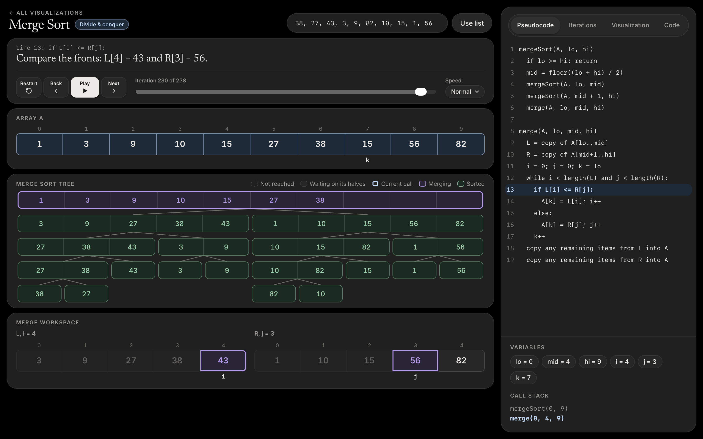

# Sort Algorithm Visualizations

Interactive, step-by-step visualizations of 12 algorithms. Follow each line of pseudocode or real code as it runs and see how it changes the data.

## Pages

- **Home (`index.html`):** a card for each algorithm, with a small preview, description, and complexity, plus a dark and light mode toggle.
- **Merge sort (`mergesort.html`):** the array, recursion tree, and `L` and `R` during each merge.
- **Quicksort (`quicksort.html`):** the pivot, the `i` and `j` pointers, and each side of the partition.
- **Binary search (`binarysearch.html`):** the `lo`, `mid`, and `hi` pointers, and how the search space shrinks.
- **Bubble sort (`bubblesort.html`):** neighbor comparisons, swaps, and the list after each pass.
- **Selection sort (`selectionsort.html`):** the smallest value so far and the list after each pass.
- **Insertion sort (`insertionsort.html`):** the key, the shifts, and the growing sorted section.
- **Heap sort (`heapsort.html`):** the array drawn as a heap, with each sift-down.
- **Shell sort (`shellsort.html`):** the shrinking gap and which values are compared together.
- **Radix sort (`radixsort.html`):** the current digit, the count array, and the output array.
- **Other special sorts (`special.html`):** links to tree sort (`treesort.html`), bucket sort (`bucketsort.html`), and odd-even sort (`oddevensort.html`).

## Features

- **Divide-and-conquer tags:** merge sort, quicksort, and binary search are labeled.
- **Pseudocode view:** highlights the current line and shows the variables and call stack.
- **Iterations view:** lists every step in execution order. Click a step to jump to it.
- **Visualization view:** shows the whole algorithm at a glance, stage by stage.
- **Code view:** shows a working implementation in C++, Java, or Python and highlights the matching lines.
- **Your own input:** enter 2 to 16 whole numbers, up to 3 digits each. Binary search sorts the list first and also takes a target.

## Run it

Open `index.html` in a browser. There's nothing to install or build. The fonts load from Google Fonts, and a fallback font is used offline.

**Keyboard shortcuts:** `←` and `→` step through the iterations, and `Space` plays or pauses.
